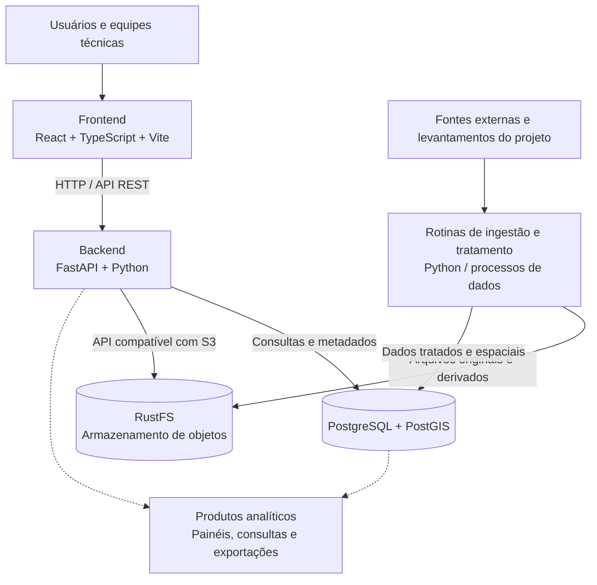

# Portal de Dados — Polo de Agricultura Irrigada do Sudoeste do Tocantins

Plataforma de integração, organização, análise e visualização de dados para apoiar o **Plano de Desenvolvimento Sustentável do Polo de Agricultura Irrigada do Sudoeste do Tocantins**.

O Portal de Dados é desenvolvido no âmbito das atividades de **Pesquisa, Desenvolvimento e Inovação (PD&I) e inteligência digital** do projeto. Seu propósito é transformar dados de diferentes origens em informações estruturadas, acessíveis e úteis para diagnósticos territoriais, acompanhamento de iniciativas, estudos técnicos e tomada de decisão.

> **Situação do projeto:** em desenvolvimento. A arquitetura descrita a seguir combina componentes já configurados e capacidades planejadas. A existência de um serviço ou camada arquitetural não significa que todas as suas funcionalidades estejam concluídas.

## 1. Propósito e objetivos

O projeto prevê a consolidação de um **Data Lake Integrado** e de uma **Base Analítica Consolidada** do Polo, com integração progressiva de bases de dados, instrumentos de consulta, painéis analíticos e recursos geoespaciais.

O Portal de Dados é uma das interfaces tecnológicas dessa iniciativa. Seus objetivos incluem:

- **Integrar fontes heterogêneas:** reunir dados secundários e, conforme disponibilização e definição de processos, dados primários provenientes de pesquisas e levantamentos do projeto.
- **Preservar os arquivos de origem:** manter cópias dos conjuntos de dados em armazenamento de objetos, com organização e possibilidade de rastrear sua procedência.
- **Estruturar e qualificar informações:** aplicar rotinas de tratamento, padronização, validação e integração, com produção de bases apropriadas para análise.
- **Organizar um catálogo de dados:** documentar conjuntos de dados, suas fontes, características e vínculos com recursos armazenados ou disponibilizados.
- **Apoiar a inteligência territorial:** oferecer consultas, mapas temáticos e visualizações sobre o território e suas características socioeconômicas, ambientais, fundiárias e produtivas.
- **Subsidiar decisões e avaliação:** favorecer diagnósticos, monitoramento e análises que contribuam para o planejamento e a avaliação das ações do Polo.

## 2. Visão geral da arquitetura

A solução utiliza uma arquitetura modular, baseada em serviços independentes e integração por APIs. Em desenvolvimento, os serviços de aplicação e armazenamento são executados com **Docker Compose**.



**Princípio de separação de responsabilidades:** o RustFS guarda os arquivos; o PostgreSQL/PostGIS mantém informações estruturadas e geoespaciais; o FastAPI oferece as regras de negócio e a API; o React apresenta os dados aos usuários. Rotinas de ingestão e transformação constituem uma camada própria, a ser desenvolvida e expandida progressivamente.

### 2.1. Componentes

| Componente                   | Tecnologias                         | Responsabilidade                                                                                         |
| ---------------------------- | ----------------------------------- | -------------------------------------------------------------------------------------------------------- |
| **Frontend**                 | React, TypeScript, Vite             | Interface de navegação, autenticação, catálogo, mapas e visualizações.                                   |
| **Backend**                  | Python, FastAPI, SQLAlchemy         | API REST, autenticação e autorização, regras de negócio, acesso ao banco e integração com armazenamento. |
| **Banco de dados**           | PostgreSQL, PostGIS                 | Persistência de usuários, domínios, metadados e dados estruturados e espaciais.                          |
| **Armazenamento de objetos** | RustFS (API S3)                     | Guarda de arquivos como CSV, GeoJSON, KML e outros formatos utilizados pelo projeto.                     |
| **Processamento de dados**   | Python e bibliotecas especializadas | Ingestão, limpeza, validação, transformação e carga de bases — em evolução.                              |
| **Orquestração de serviços** | Docker, Docker Compose              | Execução e configuração dos serviços em contêineres.                                                     |

### 2.2. Fluxo conceitual dos dados

1. **Aquisição:** identificação das fontes e obtenção dos arquivos ou registros disponibilizados ao projeto.
2. **Armazenamento:** preservação dos arquivos originais no armazenamento de objetos.
3. **Preparação:** tratamento, padronização, validação e eventual produção de arquivos derivados.
4. **Consolidação:** disponibilização de dados estruturados e espaciais no PostgreSQL/PostGIS, conforme cada caso de uso.
5. **Catalogação:** registro dos metadados e das referências aos recursos associados aos conjuntos de dados.
6. **Consumo:** acesso via API, mapas, consultas, painéis e possíveis exportações.

Esse fluxo expressa a **arquitetura-alvo**; os processos completos de ingestão, transformação, governança e publicação serão implementados por etapas.

## 3. Organização do repositório

```text
irrigacao_to/
├── docker-compose.yml       # Orquestração local dos serviços
├── README.md                # Visão geral do projeto (este documento)
├── frontend/                # Aplicação React
│   ├── Dockerfile
│   └── README.md            # Configuração e operação do frontend
├── server/                  # API FastAPI
│   ├── app/
│   ├── Dockerfile
│   ├── requirements.txt
│   └── README.md            # Configuração e operação do backend
└── storage/                 # Configurações do armazenamento RustFS
    └── README.md            # Buckets, persistência e operação do storage
```

Os arquivos `README.md` de cada serviço deverão detalhar suas respectivas variáveis de ambiente, dependências, comandos, testes e procedimentos de manutenção. O presente documento reúne apenas as informações de arquitetura e orientação geral.

## 4. Execução e ambientes

### Desenvolvimento local

A configuração atual contempla **três serviços em contêineres**: frontend, backend e RustFS. O **PostgreSQL/PostGIS permanece instalado fora do Compose**, no ambiente Windows, e é acessado pelo backend via `host.docker.internal`.

| Serviço             | Endereço de desenvolvimento  | Observação                                                                   |
| ------------------- | ---------------------------- | ---------------------------------------------------------------------------- |
| Frontend            | `http://localhost:5173`      | Servidor Vite, com atualização automática.                                   |
| API                 | `http://localhost:8000`      | FastAPI/Uvicorn, com recarregamento em desenvolvimento.                      |
| Documentação da API | `http://localhost:8000/docs` | Swagger UI.                                                                  |
| Console RustFS      | `http://localhost:9001`      | Administração do armazenamento de objetos.                                   |
| API S3 do RustFS    | `http://localhost:9000`      | Porta publicada no host; entre contêineres, utiliza-se `http://rustfs:9000`. |

Para iniciar o conjunto, a partir da raiz do repositório:

```powershell
docker compose up -d --build
```

Para consultar os serviços:

```powershell
docker compose ps
```

Para interromper:

```powershell
docker compose down
```

> **Persistência:** não utilize `docker compose down -v` sem intenção explícita de remover volumes. O RustFS utiliza volume persistente para os arquivos; o frontend também mantém um volume para dependências instaladas no contêiner.

### Implantação futura

A implantação em uma **VPS da Hostinger** é uma direção de evolução planejada, não uma configuração de produção concluída. Antes da publicação, serão necessários, entre outros pontos: Compose próprio de produção, geração estática do frontend, proxy reverso e HTTPS, gestão de segredos, redes e permissões, backups, observabilidade e avaliação da hospedagem do PostgreSQL/PostGIS.

## 5. Organização e governança dos dados

A plataforma diferencia três categorias de informação:

- **Arquivos:** recursos originais ou derivados, preservados no RustFS.
- **Dados estruturados e espaciais:** tabelas e geometrias mantidas no PostgreSQL/PostGIS.
- **Metadados:** descrições, identificadores, fontes e vínculos gerenciados pelo catálogo.

A evolução do catálogo deverá contemplar o relacionamento entre conjuntos de dados e recursos físicos, bem como informações de procedência, atualização, processamento e condições de acesso. O uso de formatos e padrões de metadados será estabelecido conforme as necessidades técnicas do projeto.

Como exemplos de **temas de interesse** para a integração territorial, destacam-se limites administrativos, hidrografia, áreas irrigadas, Cadastro Ambiental Rural (CAR), informações fundiárias, indicadores municipais e outras bases pertinentes ao planejamento do Polo. Essa relação é indicativa e não representa compromisso de disponibilidade ou integração concluída de cada base.

## 6. Desenvolvimento por etapas

O cronograma de execução do projeto estabelece seis entregas técnicas progressivas, previstas entre outubro de 2026 e julho de 2027:

| Etapa | Data prevista | Foco da entrega                                                                                             |
| ----- | ------------- | ----------------------------------------------------------------------------------------------------------- |
| 1     | 30/10/2026    | Diagnóstico de necessidades, levantamento de fontes e arquitetura inicial do Data Lake e da Base Analítica. |
| 2     | 15/11/2026    | Estruturação do ambiente tecnológico, padrões de integração e primeiros componentes do Data Lake.           |
| 3     | 15/12/2026    | Integração preliminar, tratamento, padronização e validação das bases disponíveis.                          |
| 4     | 01/02/2027    | Ampliação da integração, painéis gerenciais, consultas e visualizações.                                     |
| 5     | 01/04/2027    | Aprimoramento da plataforma, ferramentas geoespaciais, governança, segurança e testes.                      |
| 6     | 01/07/2027    | Consolidação do Data Lake e da Base Analítica, validação, documentação e relatório final.                   |

As datas são **marcos previstos de entrega**, não indicadores de conclusão das respectivas funcionalidades no software.

## 7. Situação atual e próximos desenvolvimentos

**Infraestrutura já configurada no ambiente local:**

- Execução do frontend React, da API FastAPI e do RustFS via Docker Compose.
- Conexão da API com PostgreSQL e acesso ao RustFS pela interface S3.
- Estrutura inicial de autenticação, gestão de usuários e Catálogo de Dados no backend.
- Desenvolvimento de recursos de visualização cartográfica e camadas geoespaciais no frontend.

**Frentes de evolução:**

- Concluir e testar os endpoints de gerenciamento de arquivos no FastAPI.
- Vincular recursos armazenados a registros do Catálogo de Dados.
- Organizar os pipelines de ingestão, qualidade e atualização das bases.
- Ampliar consultas, mapas, indicadores e painéis analíticos.
- Definir práticas de governança, controle de acesso, rastreabilidade e backup.
- Preparar e validar a infraestrutura de produção.

## 8. Documentação por serviço

A documentação operacional será mantida junto a cada componente:

- [`frontend/README.md`](frontend/README.md) — execução, desenvolvimento, configuração e build da interface.
- [`server/README.md`](server/README.md) — arquitetura da API, configuração, autenticação, testes e integrações.
- [`storage/README.md`](storage/README.md) — RustFS, buckets, organização dos objetos, persistência e backups.

> Os documentos específicos podem ser criados ou atualizados progressivamente, à medida que a implementação evoluir.

## 9. Contexto institucional

O Portal de Dados apoia as atividades técnicas do **Plano de Desenvolvimento Sustentável do Polo de Agricultura Irrigada do Sudoeste do Tocantins**, vinculado ao convênio nº **29/2026**, com atuação da **Fundação de Apoio Científico e Tecnológico do Tocantins (FAPTO)**. A plataforma integra o esforço de estruturação de um **Data Lake Integrado e de uma Base Analítica Consolidada do Polo**, destinados a apoiar pesquisa, desenvolvimento, inovação e a elaboração do Plano.

**Referência de escopo:** _Cronograma Físico de Execução, Entregas Parciais e Critérios de Aceite_ (30 de outubro de 2026). O documento estabelece o propósito técnico, os marcos de entrega e os critérios gerais de avaliação da iniciativa.

---

_Documento de visão geral. Instruções operacionais e detalhes de implementação devem ser consultados nos READMEs dos serviços._
